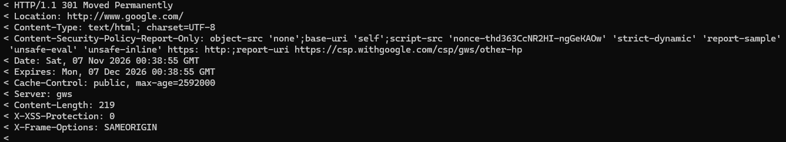
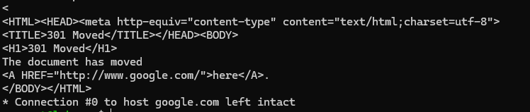

# Estrutura das Requisições e Respostas HTTP

De forma resumida é o formato que o cliente e o servidor trocam mensagens pelo HTTP!

## Estrutura de uma requisição (Request)

A estrutura é bem simples, é organizada dessa forma:

| Parte         | Exemplo                          | Descrição                                      |
|---------------|----------------------------------|------------------------------------------------|
| Linha inicial | `GET / HTTP/1.1`                 | Método, caminho e versão do protocolo          |
| Cabeçalhos    | `Host: google.com`               | Metadados da requisição                        |
| Linha em branco | `>`                            | Separa os cabeçalhos do corpo                  |
| Corpo         | _(vazio no GET)_                 | GET e HEAD normalmente não enviam body         |

## Estrutura de uma resposta (Response)

E a estrutura de resposta por fim é desta forma:

| Parte           | Exemplo                              | Descrição                                  |
|-----------------|--------------------------------------|--------------------------------------------|
| Linha de status | `HTTP/1.1 301 Moved Permanently`     | Versão, código e texto do status           |
| Cabeçalhos      | `Location: http://www.google.com/`   | Metadados da resposta                      |
| Linha em branco | `<`                                  | Separa os cabeçalhos do corpo              |
| Corpo           | `<HTML>...</HTML>`                   | Conteúdo retornado (HTML, JSON, etc.)      |

## Headers mais comuns

| Header           | Vai em      | Pra que serve                                          |
|------------------|-------------|--------------------------------------------------------|
| `Host`           | requisição  | Domínio que o cliente quer (obrigatório no HTTP/1.1)   |
| `User-Agent`     | requisição  | Quem está pedindo (navegador, curl/8.5.0)              |
| `Accept`         | requisição  | Formatos que o cliente aceita (`*/*` = qualquer)       |
| `Authorization`  | requisição  | Credenciais ou token de acesso                         |
| `Cookie`         | requisição  | Cookies que o cliente devolve ao servidor              |
| `Content-Type`   | ambas       | Formato do corpo (`text/html`, `application/json`)     |
| `Content-Length` | ambas       | Tamanho do corpo em bytes                              |
| `Location`       | resposta    | Pra onde ir, usado com 301/302                         |
| `Set-Cookie`     | resposta    | O servidor manda o cliente guardar um cookie           |
| `Server`         | resposta    | Software do servidor (`gws` no Google)                 |
| `Cache-Control`  | resposta    | Por quanto tempo guardar em cache                      |

## Exemplos práticos

Exemplo real usando `curl -v google.com`, que mostra o ciclo completo de uma requisição e resposta HTTP.

### 1. Requisição enviada pelo cliente

O curl se conecta ao Google na porta 80 e envia os cabeçalhos da requisição (linhas com `>`):

### 2. Resposta recebida do servidor

O servidor retorna o status `301 Moved Permanently` com os cabeçalhos de resposta (linhas com `<`):

### 3. Corpo da resposta (body)

Por fim, o corpo HTML é entregue — neste caso, uma página simples de redirecionamento:

