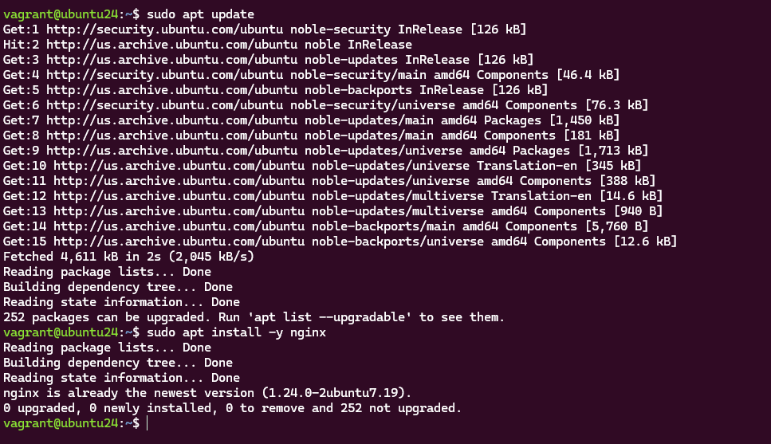
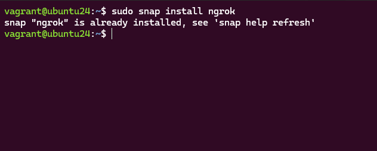
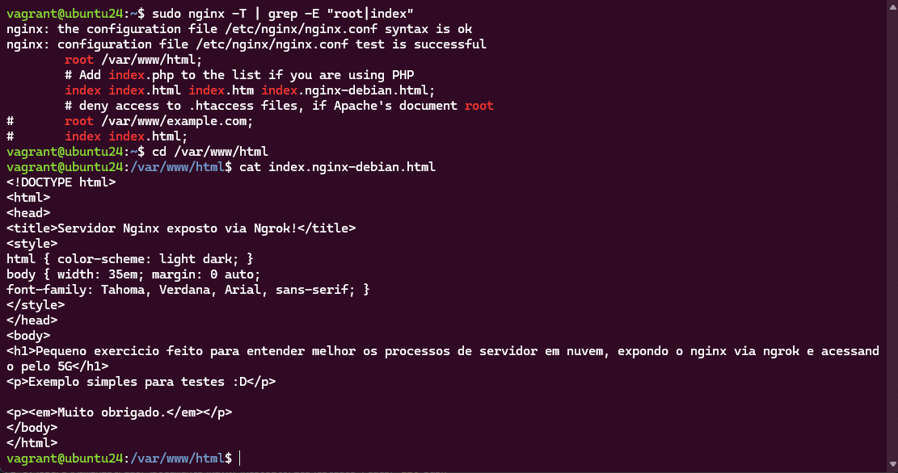
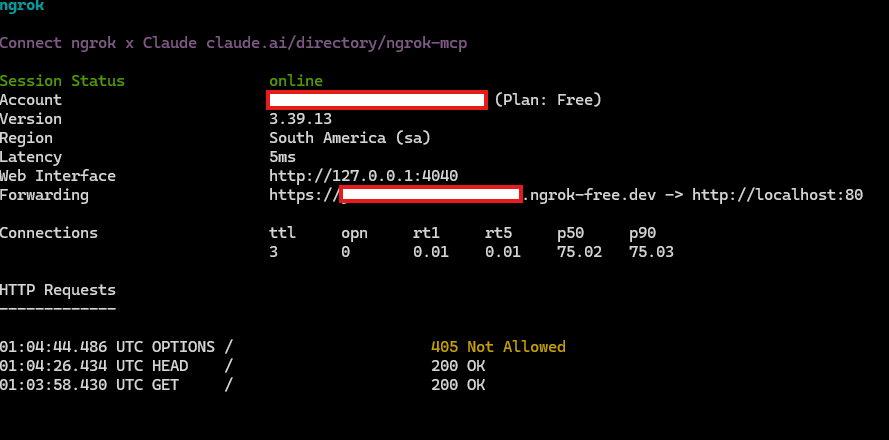
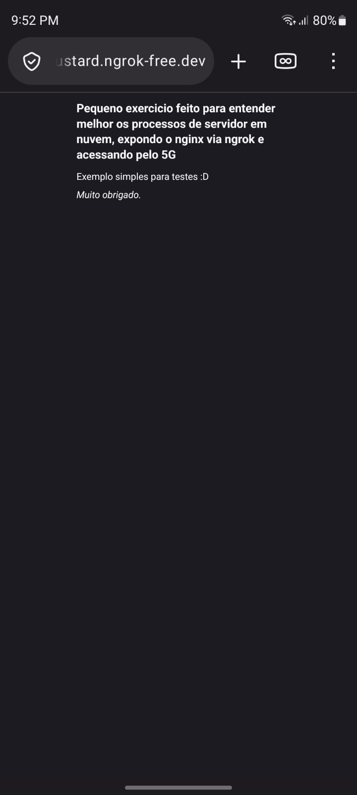
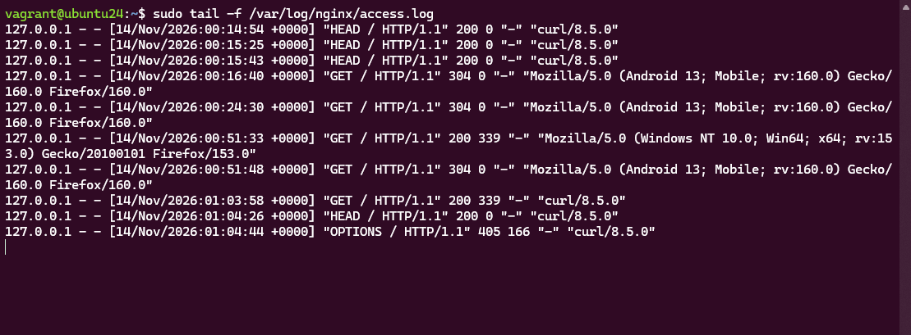

# Nginx exposto na internet com ngrok (Lab Vagrant)

Laboratório em que um servidor **Nginx** roda dentro de uma VM Linux (Vagrant + VirtualBox), é exposto na internet por um túnel **ngrok** e acessado por um celular na rede **5G**.

## Objetivo

Publicar um servidor web local (`localhost:80`) na nuvem e provar que ele é acessível de fora da rede de casa!

## Arquitetura

```
Celular (5G)
    │  https://<nome>.ngrok-free.dev
    ▼
Servidores do ngrok (nuvem)
    ▲
    │  túnel iniciado de DENTRO da VM (conexão de saída)
    │
ngrok (VM)  ──►  Nginx (VM, porta 80)
```

**Por que funciona:** o ngrok abre uma conexão de **saída** da VM até a nuvem dele. O celular acessa o endereço público do ngrok, e o tráfego volta pelo túnel até o Nginx.

**Por que não dá para usar o IP do PC no 5G:** o IP do PC é privado (`192.168.x.x`) e as operadoras móveis usam CGNAT, então conexões vindas de fora não chegam até a máquina.

## Ambiente

| Item  | Valor                             |
|-------|-----------------------------------|
| Host  | Windows com VirtualBox + Vagrant  |
| VM    | Linux baseado em Debian/Ubuntu    |
| Nginx | Instalado via `apt`               |
| ngrok | v3.x, plano Free                  |

---

## 1. Instalar o Nginx

```bash
sudo apt update
sudo apt install -y nginx
sudo systemctl enable --now nginx
systemctl status nginx --no-pager
curl -I http://localhost
```

| Comando | O que faz |
|---------|-----------|
| `apt update` | Atualiza a lista de pacotes disponíveis. |
| `apt install -y nginx` | Instala o Nginx, respondendo "sim" automaticamente. |
| `systemctl enable --now nginx` | Inicia o serviço agora (`--now`) e faz ele subir junto com a VM (`enable`). |
| `systemctl status nginx` | Mostra se o serviço está ativo. |
| `curl -I http://localhost` | Pede só os cabeçalhos da resposta. `HTTP/1.1 200 OK` confirma que o servidor responde. |

## 2. Instalar o ngrok

Instalação via `snap`:

```bash
sudo snap install ngrok
```

O `snap` já resolve dependências e mantém o pacote atualizado automaticamente. Confirme a instalação:

```bash
ngrok version
```

> Alternativa: baixar o binário diretamente em `https://ngrok.com/downloads/linux`.

## 3. Autenticar o ngrok

1. Crie uma conta em <https://ngrok.com> (plano Free).
2. Copie o **authtoken** no dashboard.
3. Registre-o na VM:

```bash
ngrok config add-authtoken "token_do_usuário"
```

O token é salvo no arquivo de configuração do ngrok no home do usuário. **Nunca publique o token no GitHub.**

## 4. Personalizar a página inicial

O Nginx serve arquivos da pasta definida em `root` e escolhe o primeiro arquivo existente da lista `index`. Veja os dois valores:

```bash
sudo nginx -T | grep -E "root|index"
```

Saída neste lab:

```
root /var/www/html;
index index.html index.htm index.nginx-debian.html;
```

O Nginx percorre a lista da esquerda para a direita e serve o primeiro arquivo que existir. Neste lab, o `index.html` não estava presente na pasta, então o arquivo servido era o `index.nginx-debian.html`:

```bash
ls /var/www/html/
sudo nano /var/www/html/index.nginx-debian.html
```

Exemplo de conteúdo:

```html
<!DOCTYPE html>
<html lang="pt-BR">
<head>
  <meta charset="UTF-8">
  <meta name="viewport" content="width=device-width, initial-scale=1">
  <title>Lab Nginx</title>
</head>
<body>
  <h1>Lab Nginx online</h1>
  <p>Nginx exposto via ngrok e acessado pelo 5G.</p>
</body>
</html>
```

- `charset="UTF-8"` evita acentos quebrados.
- `viewport` deixa a página legível no celular.

Valide localmente (o `curl` não usa cache):

```bash
curl -s http://localhost
```

Arquivos estáticos não exigem reiniciar o Nginx.


## 5. Expor com o ngrok

```bash
ngrok http 80
```

A tela do ngrok mostra:

| Campo | Significado |
|-------|-------------|
| `Session Status` | `online` quando o túnel está ativo. |
| `Forwarding` | `https://<nome>.ngrok-free.dev -> http://localhost:80`: o endereço público e o destino local. |
| `HTTP Requests` | Lista das requisições recebidas (hora, método, caminho, status). |

Copie a URL de `Forwarding`.

## 6. Testar pelo celular no 5G

1. Desligue o Wi-Fi do celular para garantir que o acesso é pela rede móvel.
2. Abra a URL do ngrok no navegador.
3. No plano Free aparece uma tela de aviso do ngrok. Toque em **Visit Site**.
4. A página do Nginx deve carregar.

## 7. Evidências

Na VM, acompanhe o log ao vivo enquanto acessa pelo celular:

```bash
sudo tail -f /var/log/nginx/access.log
```

Resultado esperado:

```
<IP> - - [data] "GET / HTTP/1.1" 200 <bytes> "-" "Mozilla/5.0 (Linux; Android ..."
```

- Na tela do ngrok, as linhas `GET / 200 OK` confirmam que a requisição passou pelo túnel.

> O endereço **MAC** do celular não aparece em nenhum lugar: ele só existe dentro da rede local e é descartado no primeiro roteador.

## 8. Encerrar

Pressione `Ctrl+C` no terminal do ngrok. O endereço público deixa de funcionar imediatamente. Não deixe o túnel aberto depois da demonstração.


## Segurança

- Não publique o authtoken do ngrok, o `policy.yaml` com senha, nem prints com e-mail ou URL do túnel.
- Feche o túnel com `Ctrl+C` ao terminar.

## Referências

- Instalação do ngrok no Linux: <https://ngrok.com/downloads/linux>
- Documentação do Nginx: <https://nginx.org/en/docs/>

## Evidências do lab

### Instalação do Nginx e do ngrok





### Configuração — nginx -T e conteúdo do HTML



### Túnel ativo no ngrok



### Acesso pelo celular no 5G



### Log de acesso do Nginx

